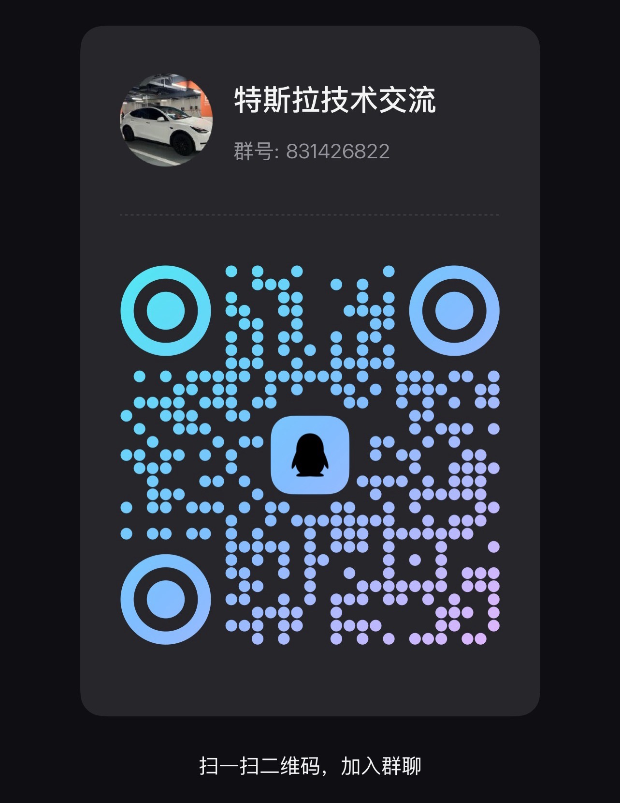

# 特斯拉哨兵云盘 · Tesla Sentry Drive

**虚拟哨兵 U 盘 · 多路同步回放 · QQ / 飞书推送 · 自定义涂装 · 锁车音自动转换**

> 拿一台带 USB 口的小 Linux 设备（随身 WiFi、开发板、电视盒子、OpenWrt 路由器……）顶替原车 U 盘插进手套箱：车机照常录制，手机 / 电脑远程回看四路、六路画面，还能逐帧读出**视频码流里的 SEI 遥测**——挡位、车速、油门 / 刹车、方向盘角度、转向灯、AP 状态、坐标，导出视频时可一并烧成水印。
>
> 没有 USB Device 模式的机器也可运行纯网页查看器：把 `TSF_ARCHIVE` 指向包含 `SentryClips/`、`SavedClips/`、`RecentClips/` 的目录，例如 `TSF_ARCHIVE=/path/to/TeslaCam python3 sentry-viewer.py --host 127.0.0.1`。完整部署、手动复制归档和仅网页三种用法见 [docs/COMPATIBILITY.md](docs/COMPATIBILITY.md)。

> 本仓库基于 [baicyber/tesla-sentry-f50](https://github.com/baicyber/tesla-sentry-f50) 重构。当前功能版本 **2.10.0**，开发和发布分支为 **`codex/modular-runtime`**。设备不自动检查更新，只在你输入 ZIP URL 并点击更新时下载，可使用 R2 直链。仓库名来自参考硬件中兴 F50 存储版；本分支的自动化验证不等同于真实设备验证。

[](LICENSE)
[](#硬件要求)
[](https://www.python.org/)
[](#硬件要求)

---

## 使用导航

- [F50 无法访问 GitHub：从 Mac 离线部署](#方式-a从-mac-离线部署)
- [设备能访问 GitHub：直接安装](#方式-b在设备上直接安装)
- [QQ 官方机器人配置](#qq-官方机器人推送)
- [车身涂装上传](#车身涂装)
- [锁车音自动转换](#锁车音自动转换)
- [已有安装升级](#已有安装升级)
- [手动 ZIP 更新与 R2 发布](docs/UPDATES.md)
- [部署细节](docs/DEPLOYMENT.md) · [新增功能完整说明](docs/FEATURES.md) · [模块结构](docs/MODULES.md)

## 2.10.0 更新

- 重设计录像资料库：大封面事件卡片、独立分类与日期筛选、清晰的时间和位置信息，并提供重置筛选与空状态。
- 统一浅色 / 深色主题、系统字体和本地 SVG 图标；网页不从外部 CDN 下载字体或图标。
- 设备设置在桌面采用侧栏分区，手机采用横向导航；登录页、播放器、导出及文件管理提示同步更新。
- 支持键盘打开事件、设置页方向键切换、对话框焦点循环及关闭后焦点恢复；适配减少动画偏好。
- 保留 QQ / 飞书、涂装、锁车音及手动 ZIP 更新流程，不添加自动更新检测。

### 2.9.0 更新机制

- 取消页面启动、打开设置时的自动远端版本检查，也不再使用 GitHub 默认更新源。
- **设置 → 更新** 输入 R2 等存储上的 ZIP 下载直链，手动点击后下载、校验、安装；支持 GET 签名 URL，可选填 ZIP SHA-256。
- 新增 `python3 tools/package_update.py`，生成专用更新 ZIP 和 `.sha256` 文件；保留完整版本切换及回滚。
- 2.8.x 及更早版本需先用 Mac 离线部署脚本安装一次 2.9.0，之后使用新 ZIP 更新页。

### 2.8.0 新增功能

- QQ 官方机器人支持单聊、群聊、文字、封面及视频；本地媒体直接上传 QQ，无需公开 F50 的文件地址。
- 涂装专用上传会校验 PNG、尺寸、大小及数量，自动创建 `Wraps/`，规范文件名，并提供恢复车机导出按钮。
- 锁车音上传会实际解码、裁剪、转为 PCM WAV 并命名为 `LockChime.wav`，不再只修改扩展名。
- 音频上传与同步使用共同的归档锁和原子写入，防止旧同步任务移走刚上传的新锁车音。

## 它是什么

车机将摄像头录像写入 USB 存储的 `TeslaCam/` 目录，其中 `SentryClips` 为哨兵事件、`SavedClips` 为手动保存、`RecentClips` 为近期录像。项目从设备侧同步这些文件，并在网页中按实际摄像头数量显示，支持常见的四路、六路布局。

这个项目让一台小 Linux 设备**伪装成那个 U 盘**：

```
┌──────────────┐   USB(供电+数据)   ┌────────────────────────────────┐
│   特斯拉车机  │ ◄───────────────► │  小 Linux 设备 (如树莓派/盒子)  │
└──────────────┘                   │                                │
                                   │  /opt/tesla-sentry/            │
   车机以为在写普通 U 盘             │   teslacam.img  ← 虚拟U盘镜像   │
                                   │        │  空闲时归档            │
                                   │        ▼                       │
                                   │   /archive (ext4)              │
                                   │        │                       │
                                   │        ▼                       │
                                   │   sentry-viewer.py :8080       │
                                   └────────────────────────────────┘
                                               ▲
                                    手机/电脑浏览器访问
```

**核心思路**：exFAT 镜像通过 USB Gadget 的 `mass_storage` 导出给车机，网页播放独立归档区中的副本。在线同步直接只读解析镜像，等文件连续两轮扫描保持稳定后复制；空闲归档和 U 盘管理需要先停止车机导出再挂载。镜像访问使用共同的进程锁，避免 Linux 挂载写入与车机导出同时进行。

---

## 特性

| 功能 | 说明 |
|---|---|
| 🗂 **虚拟 U 盘** | 默认 64 GiB 稀疏镜像，实际占用随写入增长；创建前检查完整镜像容量及 20 GiB 余量 |
| 🔌 **USB 存储模拟** | 设备作为 USB U 盘供车机录制；仅首次新建的空镜像需要车机初始化，已有录像的镜像沿用 |
| 📦 **自动归档** | 在线只读同步稳定文件；镜像空闲后也可暂停导出、挂载并补充归档 |
| 🔁 **录像保留策略** | `RecentClips` 默认保留最近 60 分钟；`SentryClips` / `SavedClips` 默认各按 14 天及 12 GiB 清理，详见配置；仅清理归档副本 |
| ⚡ **在线只读同步** | 不挂载镜像，直接解析 exFAT；默认每 15 秒扫描，需连续两轮稳定及有效文件长度，出现录像的时间取决于车机文件写入状态 |
| 🎬 **多路合成导出** | 勾选任意几路 → **浏览器本机实时合成一个多画面视频**（2×2/3×2 布局，webm 为主、Safari 为 mp4），设备只出文件流不参与转码；单路直接下载原文件，也可打包 zip；**下载/打包zip可选清晰度**（原画/720p/480p/360p，默认跟随播放清晰度）
| 🖼 **静态缩略图** | 服务端 ffmpeg 抽帧 + eMMC 缓存，列表秒开；事件内每分钟一组片段自动分组，默认播最新一组，可切换
| 🎬 **多路同步播放** | 按事件实际路数自适应布局（4 路 2×2、6 路 3×2），带摄像头名称，帧级同步校正、统一进度条、0.5x–4x 倍速 |
| 📊 **行车遥测（SEI 直读）** | 解析视频码流里特斯拉内嵌的 SEI 元数据（protobuf），播放页顶部面板实时显示：挡位 / 车速 / 油门% / 刹车 / 方向盘角度 / 转向灯 / AP 状态 / 坐标 / 三轴加速度，随进度逐帧跳动；不依赖网络与云端账号，数据永远跟着视频文件走
| 🗺 **事件元数据** | 读取车机 `event.json`：时间 / 城市 / 街道 / 坐标 / 触发原因 / 触发画面 / 活动 ID，列表卡片与播放器同步展示 |
| 🔍 **按触发原因筛选** | 手动保存、按喇叭、点击图标、物体感知⋯⋯分类下按原因一键筛选，带数量；分类切换自动重置 |
| 📅 **按日期筛选** | 触发原因下方再列一行日期胶囊（当天有事件才出现），可与原因筛选叠加；支持 `?date=2026-11-03` 深链 |
| 📶 **在线清晰度切换** | 播放器可选原画 / 720p / 480p / 360p，首次转码后缓存；大小与等待时间取决于素材和设备，转码需要 ffmpeg |
| 💧 **导出可烧录水印** | 导出时勾选"叠加行车信息水印"，把时间/位置/车速/挡位/油门/刹车以**半透明单行横条**烧录到画面顶部（约占画面高 5%，基本不挡路况），单路/多路都支持 |
| 🎨 **网页背景** | 上传 CSS / 背景图，即刻换肤 |
| 🌗 **深色 / 浅色 / 自动** | 整套界面用 CSS 变量做成双主题，右上角一键循环切换（自动模式跟随系统），播放器子页面同步换肤；只有视频画面区域保持恒定深色 |
| 🔄 **手动 ZIP 升级与回滚** | 不自动检测；输入 R2 / HTTP / HTTPS 下载直链，校验 ZIP 及全部运行文件后切换完整版本，保留上一版供回滚 |
| 🔐 **全站登录保护** | 账号密码登录（cookie 记住 30 天），页面/视频流/缩略图/下载/API 全部拦截；支持 HTTP Basic 便于脚本；同 IP 连错 8 次锁 5 分钟；右上角一键退出 |
| 🔔 **飞书推送** | 哨兵触发后自动把时间 / 位置 / 触发原因 / 触发镜头 + **触发那一帧画面** 推到飞书（默认**自建应用私聊，只有本人可见**；也可用群机器人 webhook），可推**触发那一路的短视频**或封面卡片，带「查看录像」按钮 |
| 🔔 **QQ 官方机器人推送** | AppID / AppSecret + 接收 OpenID，支持单聊、群聊、文字、封面及视频；本地媒体直接上传 QQ，无需公网服务 |
| 🔊 **锁车音自动转换** | MP3/WAV/M4A 等音频自动裁剪、转换 PCM WAV、命名为 `LockChime.wav`，同步写入 USB 根目录 |
| 🚙 **涂装管理** | 校验车型模板 PNG，自动创建 `Wraps/`、规范文件名，最多 10 个；支持预览、替换、删除及恢复导出 |
| 📂 **U 盘文件管理** | 网页直接浏览/上传/下载/删除车机 U 盘内容（临时断开、自动恢复导出） |
| 🛡 **持久化与恢复** | 配置、车辆文件和版本切换采用原子写入；开机恢复服务与 USB 导出，重要录像仍应另行备份 |
| 🔁 **弹出自动重挂** | 主机(车机/电脑)对 U 盘执行"弹出"会清空 mass_storage 的 LUN，`usb-selfheal.sh` 每 2 分钟检测并自动重新导出 |
| 🚀 **开机自启** | OpenWrt `procd` 服务，USB 网卡 / 串口 / 虚拟 U 盘可共存 |

---

## 硬件要求

| 项目 | 要求 |
|---|---|
| 设备 | 支持 **USB Device (Gadget)** 模式的 Linux 设备（USB 口能当"设备"被主机识别） |
| 内核 | `CONFIG_USB_F_MASS_STORAGE=y`（configfs 方式）或 `g_mass_storage` 模块 |
| 文件系统 | 内核支持 `exfat`（`/proc/filesystems` 里有 `exfat`） |
| 存储 | 安装目录、镜像和归档放在大容量持久化存储；新建默认镜像时，镜像所在文件系统至少需要 84 GiB 空闲空间 |
| 系统 | 安装器适配 OpenWrt（procd）、systemd，以及使用 `rc.local` / cron 的通用 Linux；实际支持取决于固件和 USB 内核能力 |
| Python | 3.7+，**查看器零第三方依赖**（纯标准库） |
| 媒体工具 | ffmpeg / ffprobe 用于缩略图、设备端转码和音频格式转换；中文水印还需中文字体 |

> 中兴 F50 不同固件和存储布局可能不同。离线包包含本项目程序，不包含固件、Python、USB / exFAT 内核模块、ffmpeg 或字体。

**先自检再动手**：在候选设备上跑 `sh scripts/tsf-check.sh`，它会逐项告出 UDC / configfs / exFAT / Python / init 系统是否满足，并给出结论。完整设备清单（随身 WiFi、开发板、电视盒子、x86 为何不行、各系统适配度、功能降级矩阵）见 **[docs/COMPATIBILITY.md](docs/COMPATIBILITY.md)**。

> 没有 USB Device 模式的机器（绝大多数 x86、NAS、软路由）跑不了"虚拟 U 盘"，但仍可作为**网页查看器**使用：把车机 U 盘或已归档的 `TeslaCam/` 放到本机，`TSF_ARCHIVE=/path python3 sentry-viewer.py` 即可。

---

## 快速开始

先确认设备具备 root SSH、Python 3.7+、USB Gadget 和 exFAT 支持。默认安装目录为 `/opt/tesla-sentry`，归档为 `/archive`，端口为 `8080`；两个存储路径都应位于大容量持久化分区。已有安装请先看[升级步骤](#已有安装升级)。

### 方式 A：从 Mac 离线部署

**F50 访问 GitHub 受阻时使用此方式。** 在可访问 GitHub 的 Mac 上取得本分支，Mac 还需有 Python 3 和 SSH 客户端：

```sh
git clone --branch codex/modular-runtime --single-branch https://github.com/TLS853/tesla-sentry-f50.git
cd tesla-sentry-f50
sh tools/deploy_f50.sh root@设备IP
```

替换设备 IP，并按提示输入设备 SSH 密码。脚本在 Mac 上生成离线包，通过 SSH 标准输入上传，随后在 F50 后台启动安装。**F50 无需 git、SFTP 或访问 GitHub。**

上传结束会打印 `INSTALL_LOG`。重新 SSH 登录 F50，执行输出中的 `tail -n 80 .../install.log` 查看结果；“已上传”只说明安装已启动，不代表安装成功。

需要指定实际存储分区时，在 Mac 执行，替换示例路径：

```sh
sh tools/deploy_f50.sh root@设备IP --dir /大容量分区/tesla-sentry --archive /大容量分区/archive --size 64 --port 8080
```

非默认 SSH 端口使用 `SSH_PORT=2222 sh tools/deploy_f50.sh root@设备IP`。也可用 `python3 tools/package_release.py` 单独生成 `dist/tesla-sentry-f50-2.10.0-offline.tar.gz`；手动上传、校验及安装步骤见[离线部署说明](docs/DEPLOYMENT.md)。

离线安装跳过字体下载；所有安装方式都不自动检查更新。QQ / 飞书推送仍需 F50 能访问各自官方服务，与能否访问 GitHub 无关。

### 方式 B：在设备上直接安装

设备可访问 GitHub 且已安装 git 时，用 root SSH 登录设备后执行：

```sh
git clone --branch codex/modular-runtime --single-branch https://github.com/TLS853/tesla-sentry-f50.git
cd tesla-sentry-f50
sh scripts/tsf-check.sh
sh install.sh --size 64 --port 8080 --archive /archive
```

安装器检查依赖与空间，保留已有镜像及配置，安装完整程序包，注册查看器、在线同步和 USB 服务，并设置定时归档。只有不存在镜像时才新建稀疏文件；`--size` 不会调整已有镜像的容量。非 root 用户需用 `sudo sh install.sh ...`。

### 接入车机与首次登录

把设备接到车机具备数据传输能力的 USB 口。**仅首次新建的空镜像**需要按车机提示初始化；已有录像的镜像无需重新格式化。车机随后在 `TeslaCam/` 下录制。

浏览器访问 `http://<设备IP>:8080`：

- 手机连设备热点，或
- 设备 USB 网卡直连电脑，或
- 自行加 Tailscale / frp 等实现公网访问（**本项目不包含内网穿透**）

安装器首次生成 `admin` 账号和随机密码，在安装日志中显示；升级保留原账号。登录后可在 **设置 → 账号** 修改密码。

正常情况下在线同步按稳定文件复制，不必等待定时归档。定时归档每 10 分钟检查，镜像空闲达到 `TSF_IDLE`（默认 600 秒）才挂载补充归档并写入音频。录制中的文件可能尚未稳定，不承诺固定显示延迟。

---

## 网页功能

### 主界面

- 三个分类：**哨兵告警 / 手动保存 / 行车记录**，带事件计数
- 每张卡片按事件实际路数显示拼图缩略，按时间线倒序
- 点开进入**多路同步播放器**：4 路自动 2×2、6 路自动 3×2，每格标注摄像头名称；帧级同步（偏差 > 0.35s 自动对齐）、统一进度条、倍速
- 支持 `?ev=SentryClips/2026-11-04_12-30-00` 深度链接直接打开某个事件

### ⚙ 个性化面板

| 标签 | 功能 |
|---|---|
| 🎨 网页背景 | 上传 `.css` / `.jpg` / `.png` / `.webp`；CSS 里用 `/skin-media/文件名` 引用图片 |
| 🔊 锁车语音 | 源音频最大 20 MiB，默认取前 5 秒，自动生成小于 1 MB 的 `LockChime.wav`，等待空闲同步写入 USB 根目录 |
| 🚙 涂装 | 上传对应车型 PNG（512–1024 正方形、≤1 MB），自动创建根目录 `Wraps/`，车机端选择；支持预览与删除 |
| 📂 文件 | **车机U盘**：浏览/上传/下载/删除 U 盘任意目录（含根目录）；**归档区**：浏览 F50 内部文件 |
| 🔔 推送 | 选择 QQ 官方机器人或飞书，推送新增事件；见 [QQ 配置及车辆文件使用说明](docs/FEATURES.md) 和 [飞书推送](#飞书推送) |
| 🌐 **多语言** | 界面支持中/英/德/法/意/西/荷/俄/日/韩，设置 → 语言 里切换，保存在本机浏览器 |
| 🔄 更新 | 显示本机版本，输入 ZIP URL 后手动下载并更新，支持回滚（见 [手动 ZIP 更新](#手动-zip-更新r2)） |

**锁车音转换**：项目自动输出 44.1kHz / 16-bit / 单声道 PCM WAV，最长 5 秒、小于 1 MB，保存为 USB 根目录的 `LockChime.wav`。这是本项目采用的输出配置；车机端在 Toybox → Boombox → Lock Sound 选择 USB，需要车辆支持该功能。详见 [使用说明](docs/FEATURES.md)。

**U 盘文件管理模式**：点「连接车机U盘」→ 停止导出、挂载镜像 → 网页上改动直接写进车机 U 盘 → 点「恢复车机导出」或 **5 分钟无操作自动恢复**。行车/哨兵活跃时不要长时间挂着。

---

## 配置

配置文件：`/etc/tesla-sentry.conf`

```sh
TSF_DIR=/opt/tesla-sentry        # 安装目录
TSF_IMG=/opt/tesla-sentry/teslacam.img   # 虚拟U盘镜像
TSF_ARCHIVE=/archive             # 归档区 (ext4, 建议独立于镜像)
TSF_MNT=/tmp/teslamnt            # 临时挂载点
TSF_LOOP=/dev/loop3              # 挂载用 loop 设备
TSF_PORT=8080                    # 网页端口
TSF_IDLE=600                     # 镜像空闲多少秒才归档
TSF_LIVE_INTERVAL=15             # 在线只读同步轮询间隔 (秒)

# 归档滚动窗口: 只保留归档区最近 N 分钟的 RecentClips 副本,
# 不删除车机镜像里的文件; 实际空间增长取决于录制时长、码率及摄像头数量
TSF_RECENT_ROLL_MIN=60           # 滚动窗口 (分钟), 0 = 关闭滚动、永久归档
                                 # 注意: tesla-live-sync.py 与 sentry-viewer.py 都读这个变量,
                                 # 两边必须一致 —— 同步端在"抄之前"就按窗口过滤, 查看器端负责清掉
                                 # 已在归档里的旧副本; 若只配查看器, 清掉的片段会被当成新片段重抄,
                                 # 形成 删除→重抄 的死循环, 新片段反而迟迟不落地

# 空间兜底: 万一别的数据把盘吃满, 剩余低于 FREE_MIN 时再淘汰最旧的 RecentClips,
# 清到 FREE_TARGET 为止 (哨兵/手动保存的归档由下面的定期清理管, 不参与兜底)
TSF_FREE_MIN_MB=4096             # 触发阈值 (MB)
TSF_FREE_TARGET_MB=10240         # 清理目标 (MB)
TSF_RECENT_KEEP_MIN=60           # 兜底清理时最近 N 分钟的片段无论如何保留

# 哨兵/手动保存归档定期清理: 只清归档副本, 不改动车机镜像。两个维度独立生效:
#   按天数 —— 只保留该分类最新事件往前 N 天内的归档 (锚点是最新事件而非当前时间,
#             停车几天没新事件不会被误清空); 按体积 —— 单个分类超过 MAX_GB 就从最旧的删
TSF_BOX_KEEP_DAYS=14             # 保留天数, 0 = 不按天数清
TSF_BOX_MAX_GB=12                # 单个分类体积上限 (GB), 0 = 不按体积清
                                 # 提示: 12G/类按 64G 镜像 + 常见存储空间设计;
                                 # 想多留就调大, 但注意剩余空间, 兜底清理不覆盖这两个分类

# TSF_USB_LOCK=/tmp/tesla-sentry-usb.lock  # 所有访问镜像的进程必须使用同一锁路径
```

旧的 `TSF_OTA_ENABLED`、`TSF_OTA_REPO`、`TSF_OTA_REF`、`TSF_OTA_SOURCES` 已不参与更新；不需要为 R2 配置访问密钥或修改设备更新源，直接使用可下载的 ZIP URL。

### 已有安装升级

1. 停车并停止车机录制，备份重要录像与配置，在网页退出 U 盘管理模式。
2. 从 Mac 更新本地分支，重新运行离线部署脚本；或在设备上取得本分支并重跑安装器。OpenWrt 升级前先停止旧查看器和在线同步：

```sh
/etc/init.d/sentry-viewer stop
/etc/init.d/tesla-live stop
```

3. 检查安装日志，再打开网页确认功能。安装器沿用已配置或正在导出的镜像，不需要通过卸载、格式化来升级；镜像被占用时会拒绝版本切换，等待占用结束后重试。

从旧版首次升级到模块化版本应重跑安装器，以更新服务的配置加载方式。只更新 Python 文件不会重写既有的服务定义。通用 `rc.local` 部署需确保旧进程退出，必要时重启设备。详细步骤见[部署文档](docs/DEPLOYMENT.md)。

### 手动 ZIP 更新（R2）

**2.9.0 起不会自动检测或下载更新。** 打开更新页只读取本机状态，不请求 GitHub 或 R2。

在源码目录生成更新包：

```sh
python3 tools/build.py
python3 tools/package_update.py
```

将生成的 `dist/tesla-sentry-f50-2.10.0-update.zip` 上传到 R2，取得公开下载直链或私有对象的 GET 预签名 URL。网页 **设置 → 更新** 粘贴完整 URL，可选填 `.sha256` 文件中的 64 位校验值，然后点击 **下载 ZIP 并更新**。

设备下载并检查 ZIP 格式、文件清单、每个文件的 SHA-256 和版本，运行自检后切换完整版本目录并重启服务。配置、账号、QQ / 飞书凭据及录像保留，上一完整版本可通过 **回滚到上一版本** 恢复。下载由 F50 服务端执行，不需要浏览器直接访问 R2，也不需要在设备保存 R2 密钥。

只接受高于当前运行版本的包，同版本安装和直接降级会被拒绝。压缩包最大 16 MiB。不能使用 GitHub 源码 ZIP、普通目录压缩包或 `*-offline.tar.gz`；必须使用专用打包脚本。旧版 2.8.x 需先用前述 Mac 离线部署流程安装一次新机制。

后续发新版，先用 `python3 tools/make_release.py 2.10.1 "更新说明"` 递增版本并构建，再运行 `python3 tools/package_update.py`。完整 R2 上传、局域网下载、校验和回滚说明见 [docs/UPDATES.md](docs/UPDATES.md)。

### 开发与构建

源码是可直接导入的 Python 包 `src/tesla_sentry/`，前端资源放在 `src/tesla_sentry/web/`。两个根目录 Python 文件是构建产物，设备仍只依赖 Python 3.7+ 标准库。

```sh
# 从源码启动，方便调试；只查看归档时不需要 USB 硬件
PYTHONPATH=src python3 -m tesla_sentry serve --host 127.0.0.1 --port 8080 --archive /path/to/archive
PYTHONPATH=src python3 -m tesla_sentry check
PYTHONPATH=src python3 -m tesla_sentry sync --once

# 生成并核对可独立部署的入口和完整程序包
python3 tools/build.py
python3 tools/build.py --check
python3 -m unittest discover -s tests -v
# 可选：前端模块测试，无需 npm 依赖
node --experimental-vm-modules tests/frontend.mjs
```

构建器将原始模块、HTML、CSS、JavaScript 和翻译表压缩进独立入口。运行时保持每个模块自己的命名空间和显式导入，开发与设备部署使用相同的包。浏览器使用原生 ES 模块，不需要 Node.js 构建工具。[模块与依赖说明](docs/MODULES.md) 记录了各层职责和兼容边界。

`sentry-viewer.py`、`tesla-live-sync.py`、`dist/release.json` 为生成文件；修改 `src/tesla_sentry/` 后运行构建器，不直接修改生成的入口。发布新版本时先递增版本并构建，再用 `tools/package_update.py` 生成更新 ZIP；完整离线安装包仍由 `tools/package_release.py` 生成。仅提交并推送到 `codex/modular-runtime`，不合并到 `main`。

`config.py` 统一读取配置：环境变量优先于 `TSF_CONF`（默认 `/etc/tesla-sentry.conf`），再使用默认值。配置文件采用 `TSF_NAME=value`，含空格的值须加引号；Python 入口不会执行文件中的 Shell 命令。启动时校验端口、轮询间隔和并发限制，错误配置会给出具体提示。

`dist/release.json` 包含查看器、实时同步程序与五个 Shell 工具，须与 `version.json` 一起提交。安装后程序入口指向 `current/`，升级与回滚通过一次替换符号链接切换整个版本；配置、镜像和录像保存在版本目录之外。旧客户端只更新查看器时，新入口会使用内嵌配套脚本迁移完整程序包。

2.10.0 通过 Python 回归、前端模块及真实浏览器检查。浏览器覆盖浅深主题、320 / 360 / 390 像素手机、平板、桌面及英文界面，检查筛选、空状态、播放器、导出、设置焦点和手动更新表单；文字主题色及主按钮的检查目标为至少 4.5:1 对比度。录像事件、缩略图和视频是演示数据，不代表真实车辆录像或设备负载验证。

仅预览本地界面（临时数据、只监听本机、禁止写入，不启动 USB 或同步后台任务）：

```sh
python3 tools/preview_ui.py --port 8080
```

浏览器打开 `http://127.0.0.1:8080`；`/login` 可单独预览登录页。安装了 Node.js、Playwright 和 Chromium 的开发环境，可另开终端运行 `node tests/ui.cjs http://127.0.0.1:8080 /tmp/tesla-sentry-ui`，生成演示事件的桌面、手机及设置截图。可通过 `TSF_PLAYWRIGHT_PATH`、`TSF_BROWSER_BIN` 指定已有工具路径；这些工具不是设备运行依赖。

### 多语言

设置 → 🌐 语言 里切换界面语言：中文 / English / Deutsch / Français / Italiano / Español / Nederlands / Русский / 日本語 / 한국어。选择保存在本机浏览器；首次打开会按浏览器语言自动选择。登录页会按浏览器 `Accept-Language` 自动匹配。

### QQ 官方机器人推送

1. 在 [QQ 开放平台](https://q.qq.com/) 创建机器人，取得 **AppID / AppSecret**，按平台要求配置消息权限、测试成员或发布状态。
2. 添加机器人为好友，或将机器人加入目标群，允许其发送主动消息。
3. 从该机器人的已验证事件中取得接收 ID：单聊为 `C2C_MESSAGE_CREATE` 的 `d.author.user_openid`，群聊为 `GROUP_AT_MESSAGE_CREATE` 的 `d.group_openid`。**不能填 QQ 号或群号**；不同 AppID 对应的 OpenID 不通用。
4. 网页 **设置 → 推送 → QQ 官方机器人**，选择单聊或群聊，填写 AppID、AppSecret、OpenID。先选「仅文字」，保存并发送测试；没有归档录像也可测试 QQ。
5. 测试成功后启用推送，并按需选择封面或触发摄像头视频，再保存设置。

本项目负责出站推送，不启动事件接收服务；没有现成 OpenID 时，需先通过已有机器人服务或[官方事件接入方式](https://bot.q.qq.com/wiki/develop/api-v2/)接收一次消息。凭据、OpenID 和界面截图不要公开提交到仓库。

图片及视频通过官方接口直接上传，无需公开 F50 的文件、域名或端口。「查看链接前缀」可选，仅用于消息中的网页链接。AppSecret 不回传到页面；保存其他设置时留空即保留。主动推送仍受平台权限、接收方开关、频控及网络限制。

| 推送内容 | 行为 |
| --- | --- |
| 仅文字 | 时间、位置、原因、镜头及可选查看链接 |
| 封面图片 | 抽取触发画面并附事件信息；无法取帧或上传失败时回落文字 |
| 触发摄像头视频 | 截取 10–60 秒，可选 360p / 480p / 720p；图片限 20 MiB、视频限 30 MiB |

QQ 和飞书当前只向**选中的一个渠道**发送，切换渠道保留另一渠道配置。手动导出的「推送到已选渠道」也支持 QQ。完整说明见 [docs/FEATURES.md](docs/FEATURES.md)。

### 车身涂装

1. 从 [Tesla 官方模板仓库](https://github.com/teslamotors/custom-wraps) 取得对应车型及年款的模板或成品，上传制作好的**静态 PNG**；普通照片不会自动生成车身 UV 布局。
2. 文件须为 **512×512 至 1024×1024 的正方形、≤1,000,000 字节**；USB 最多 10 个涂装。改 JPG / WebP 的扩展名不会转换图片。
3. 停车后进入 **设置 → 涂装 → 连接车机 U 盘**，管理期间车机读写及录制暂停。上传后自动创建 USB 根目录 `Wraps/`，规范文件名；同名替换需要确认。
4. 点击 **完成并恢复车机导出**，再到车机 **玩具箱 → 喷漆车间 → 涂装** 选用。需要车型及车机软件支持；网页上传不能代替车机选择。

### 锁车音自动转换

1. 打开 **设置 → 锁车语音**，上传 WAV / MP3 / M4A / AAC / FLAC / OGG / OPUS / WEBM，源文件最大 **20 MiB**。
2. 可指定起始时间和 0.1–5 秒时长，默认取前 5 秒。自动解码、裁剪、降混为单声道、重采样为 **44.1 kHz / 16-bit PCM WAV**，命名为 **`LockChime.wav`**；5 秒约 441 KB，低于 1 MB。
3. 转换成功后进入待写入队列，在镜像空闲后的归档同步中写到 **USB 根目录**。管理模式未退出、镜像持续写入时会等待；「已写入」只表示文件已复制，不代表车机已选用。
4. 在车机 **玩具箱 → Boombox → 锁车音 → USB** 选择。需要外部行人警示扬声器及兼容软件。

转换失败保留之前的队列文件。历史队列的 WAV / MP3 可点击「设为锁车音」，现在也会实际转换。其他格式依赖设备的 ffmpeg；缺少 ffmpeg 时，仅已符合上述 PCM 规格的 WAV 可直接裁剪、命名。输出规格为本项目选择的转换配置，不应将所有参数都理解为 Tesla 的官方强制要求。

### 飞书推送

哨兵一触发，手机就能收到带触发画面的飞书消息。网页 **⚙ → 🔔 推送** 里配置，两种方式：

**方式 A（推荐）— 自建应用私聊：只有你本人能看到**

消息只进「你和机器人」的单聊，同企业其他成员看不到。

1. [飞书开放平台](https://open.feishu.cn/app) → 创建**企业自建应用**
2. 「添加应用能力」→ 勾 **机器人**
3. 「权限管理」加 `im:message`（发消息）、`im:resource`（上传图片），然后**创建版本并发布**（管理员审核通过）
4. 「凭证与基础信息」里复制 **App ID / App Secret**
5. 网页 **⚙ → 🔔 推送**：接收方式选 **私聊推送**，填 **接收人**（你的 open_id `ou_...`，或飞书登录邮箱）、App ID、App Secret → **保存设置** → **发送测试**

> 拿不到 open_id 时：先在好友里搜到这个机器人，随便发一句话，再看开放平台「事件与回调」的日志；或直接在开放平台「API 调试台」选「获取用户信息」查自己的 open_id。

**方式 B — 群机器人 webhook：群里所有人都能看到**

1. 飞书群 → 右上角设置 → **群机器人** → 添加机器人 → **自定义机器人** → 复制 webhook（形如 `https://open.feishu.cn/open-apis/bot/v2/hook/xxxx`）
2. 接收方式选 **群机器人**，把 webhook 粘进去，勾 **启用推送** → **保存设置** → **发送测试**

两种方式都支持带封面图（需填 App ID / App Secret 上传图片）：

配好后每条推送都会附带**真正触发哨兵的那颗摄像头、触发那一帧**的截图（取不到时回落前视第 1 秒）。

**推送内容：封面卡片 还是 短视频**

私聊模式下可二选一（群机器人只能发卡片）：

| 选项 | 说明 |
|---|---|
| 封面卡片 | 触发那一帧 + 时间/位置/原因/镜头，最快（转码 0 秒） |
| 触发摄像头视频 | 从**触发点前 5 秒**起截一段（默认 30 秒，可调 10–60），先在本机用 ffmpeg 压到 360p / 480p / 720p 再上传，附一条精简卡片方便点回网页看多路 |

视频大小和处理耗时取决于内容、设备及网络；项目会检查上传大小，超限时需缩短片段或降低清晰度。

**QQ / 飞书共用的自动推送规则**

- 只在**新增**哨兵事件时推（首次启用不补历史，避免一开就刷屏；超过 6 小时的旧事件也不补）
- 事件新旧按**目录名里的时间**判定，不按文件 mtime：车机 U 盘循环覆盖后，定时归档会把旧片段重新抄进 `/archive`，复制出来的文件 mtime 是"抄写时刻"，只看 mtime 会把几天前的录像当成新事件连推
- 目录名时间超过 24 小时的片段只记账、不推送（24 小时余量用于吸收车机与盒子的时区偏差）
- 等片段写完（默认延迟 20 秒）再推，避免封面是半截视频；可调 5–600 秒
- 支持「也推手动保存」（SavedClips）；每条失败最多重试 3 次
- 推送视频自动烧录**行车信息水印**（时间/位置/车速/挡位/油门/刹车，与网页播放器同款）；行车片段带 SEI 遥测即生效，停车哨兵片段无遥测不烧。水印渲染需要中文字体（放 `/opt/tesla-sentry/fonts/`）
- 状态与去重记录在 `$TSF_DIR/notify-state.json`，配置在 `$TSF_DIR/notify.json`

### 访问认证

网页默认带登录保护（`install.sh` 会自动生成随机密码）。凭据在独立文件 `$TSF_DIR/auth.conf`（权限 600）：

```sh
user=admin            # 用户名
pass=xxxxxxxxxx       # 明文密码；也可以改用 sha256=<hash> 免明文
ttl=2592000           # 登录状态保留秒数 (默认 30 天)
secret=               # 可选: 签名密钥, 留空则由密码派生, 改密码即让所有会话失效
```

- 除登录页外**全部路径都要认证**：页面、`/media` 视频流、`/thumb` 缩略图、`/dl` 下载、`/api/*` 接口、`/api/export` 打包
- 登录后写 HMAC 签名 cookie，供视频、下载和 API 使用；改密码使旧会话失效，退出登录清除当前浏览器的 cookie
- 同时支持 HTTP Basic（`curl -u admin:密码`），方便脚本调用
- 网页 **⚙ → 🔑 账号** 里可以改密码和**退出登录**：改完本机自动用新密码重新登录，其它设备上的登录状态立即失效（`auth.conf` 里的 `secret` 会换新）
- 同一 IP 10 分钟内连错 8 次锁 5 分钟
- 删掉 `auth.conf` 并重启即关闭认证（**只有纯内网使用才建议**）
- ⚠️ 认证本身走 HTTP 明文传输，公网穿透时请务必套一层 HTTPS（或用 FRP 的 TLS/stcp），否则密码可被中间人看到


手工修改配置文件后重启对应服务；网页改密与推送设置保存后直接生效。OpenWrt 例如：

```sh
/etc/init.d/sentry-viewer restart
/etc/init.d/tesla-live restart
```

---

## 目录结构

```
/opt/tesla-sentry/
├── current -> releases/release-.../   # 当前完整版本
├── releases/                         # 已校验的程序版本
├── sentry-viewer.py -> current/...   # 网页入口
├── tesla-live-sync.py -> current/... # 在线只读同步入口
├── tesla-gadget.sh -> current/...    # USB on|off|status
├── tesla-sync.sh -> current/...      # 空闲归档及音频写入
├── tesla-img.sh -> current/...       # 镜像管理
├── usb-selfheal.sh -> current/...    # 被弹出后的导出恢复
├── tsf-check.sh -> current/...       # 设备自检
├── previous-release.json            # 上一版本位置
├── teslacam.img                      # 默认镜像位置，也可能沿用其它路径
├── auth.conf                         # 登录凭据
├── notify.json                       # QQ / 飞书推送配置
├── notify-state.json                 # 自动推送状态与去重
└── cache/                            # 非 F50 默认缓存；存在 /opt/mu300 时使用该目录

/archive/                # 归档区 (ext4)
├── SentryClips/         # 哨兵告警归档
├── SavedClips/          # 手动保存归档
├── RecentClips/         # 行车记录归档
├── .skins/              # 网页背景
├── boombox-queue/       # 待写入车机U盘的音频
├── boombox-done/        # 已写入的音频
└── files/               # 通用文件中转
```

车机可见的 USB 镜像内：

```text
USB 根目录/
├── TeslaCam/            # 车机录像，不是查看器的程序目录
├── Wraps/               # 通过涂装页上传的 PNG
└── LockChime.wav        # 队列同步完成后写入的锁车音
```

---

## API

| 接口 | 方法 | 说明 |
|---|---|---|
| `/api/events` | GET | 归档事件列表（按分类，含 `event.json` 元数据） |
| `/login` | GET / POST | 登录页；POST 表单 `u/p/next`，成功后设置签名 cookie |
| `/logout` | GET | 清除当前浏览器登录 cookie |
| `/api/auth/info` · `/api/auth/pass` | GET / POST | 认证状态与改密（POST JSON `old/new`） |
| `/api/live` | GET | 在线同步健康状态及存储信息 |
| `/media/<cat>/<event>/<file>` | GET | 视频流（支持 Range）；追加 `?q=360p/480p/720p` 返回按需转码的低码率副本（缓存于 `TSF_CACHE/res-cache`，单任务串行转码，失败自动回退原文件） |
| `/thumb/<cat>/<event>/<file>` | GET | 缩略图（服务端抽帧 + eMMC 缓存，空文件自动重建） |
| `/api/telemetry?path=` | GET | 解析该片段内嵌 SEI 遥测，返回逐帧 `frames[]` 与最高/平均车速、刹车占比；无 SEI 返回 `{ok:false}`，结果缓存在 eMMC |
| `/api/browse?dir=` | GET | 浏览归档区目录 |
| `/api/usb/attach` | POST | 连接车机U盘（临时停止导出 + 挂载） |
| `/api/usb/detach` | POST | 恢复车机导出 |
| `/api/usb/browse?dir=` | GET | 浏览车机U盘（相对路径） |
| `/api/upload/usb` | POST | 上传到车机U盘（multipart: `file`, `path`） |
| `/api/upload/wrap` | POST | 校验 PNG、创建 Wraps 并写入（`file`, 可选 `overwrite=1`，需 USB 管理模式） |
| `/api/upload/file` | POST | 上传到归档区（multipart: `file`, `path`） |
| `/api/upload/skin` | POST | 上传皮肤 |
| `/api/upload/audio` | POST | 上传并转换锁车音（`file`, 可选 `start=0`, `duration=5`），返回文件名、时长与大小 |
| `/api/audio` | GET | 待写入和已写入的音频列表 |
| `/api/audio/setlockchime` | POST | 将历史队列音频实际转换为 LockChime.wav |
| `/api/ota/status` | GET | 本机版本、手动 ZIP 模式、忙状态和回滚是否可用；不请求远端 |
| `/api/ota/check?force=1` | GET | 旧客户端兼容接口，仅返回本机状态，force 不会触发远端请求 |
| `/api/ota/apply` | POST | JSON `url` 为 ZIP 直链，可选 `sha256`；手动下载、校验、自检、切换版本并重启 |
| `/api/notify` | GET | 推送渠道配置、就绪状态与最近结果；不返回应用密钥 |
| `/api/notify/save` | POST | 保存配置；QQ 使用 `provider=qq`, `qq_app_id`, `qq_app_secret`, `qq_target_type=user/group`, `qq_openid`；密钥留空保留 |
| `/api/notify/test` | POST | 向已保存渠道发送测试消息；QQ 无录像时也可测试 |
| `/api/push/upload?cat=&name=&q=` | POST | 原始视频作为请求体，转码后发往已选渠道，最大 300 MiB |
| `/api/ota/rollback` | POST | 回滚到升级前备份的版本并重启 |
| `/usbdl?path=` · `/dl?path=` | GET | 下载（U盘 / 归档区）；`/dl` 追加 `&q=360p/480p/720p` 返回转码副本 |
| `/api/usb?path=` · `/api/file?path=` | DELETE | 删除（U盘 / 归档区） |

---

## 工作原理（给想改的人）

1. **USB Gadget**：设备的 USB 控制器（UDC）通过 configfs 暴露一个复合设备 = `ncm`（USB 网卡）+ `acm`（串口）+ `mass_storage`（U 盘）。厂商固件通常已建好前两个，本项目只往现有 gadget 里**加**一个 `mass_storage` 功能并重新绑定，所以网卡/串口不会丢。
2. **镜像与归档**：exFAT 镜像供车机录制，网页使用独立归档目录中的副本。它们可以位于同一物理存储，归档使用持久化文件系统；原子写入和日志式文件系统不等于断电时不会丢失任何数据。
3. **归档时机**：以镜像文件的 `mtime` 判断"车是否在写"。空闲超过 `TSF_IDLE` 秒才动手，避免打断行车录制。
4. **挂载归档**：镜像满足空闲条件时暂停导出，完成复制并卸载后恢复。耗时取决于待复制数据量；判断依据是镜像时间戳，不是与车机协商的录制状态。
5. **断电自愈**：开机时 `tesla-gadget` 自启重新导出镜像；`sentry-viewer` 启动时若发现残留挂载会自动卸载并恢复导出。
6. **文件管理互斥**：网页 U 盘管理模式挂载镜像期间，归档任务检测到挂载点被占用会自动跳过，避免抢 loop/UDC。
7. **在线只读同步**：`tesla-live-sync.py` 不挂载正在导出的镜像，直接解析 exFAT 引导扇区、FAT 表和目录项，沿簇链读取稳定的文件内容；这一同步路径不停止 USB 导出。
   - **"写完"判定**：exFAT 目录项的 `DataLength` 要文件关闭才落最终值，所以要求「长度 > 0 且连续两轮扫描签名一致」才拷贝，避免搬出半截 mp4（缺 `moov` 头放不了）。
   - **扫描间隔**：默认 15 秒，连续两轮稳定才复制，具体延时还受车机文件长度及落盘时机影响。
   - **兜底**：`tesla-live-sync` 不可用时，`tesla-sync.sh` 会在镜像空闲后照旧挂载归档（此时才会短暂断开 U 盘）。

更多细节见 [docs/ARCHITECTURE.md](docs/ARCHITECTURE.md)、[docs/COMPATIBILITY.md](docs/COMPATIBILITY.md)、[docs/TROUBLESHOOTING.md](docs/TROUBLESHOOTING.md)。

---

## 常见问题

**Q：车机不认盘 / 提示无法读取？**
先确认 `/sys/class/udc/` 有控制器、`/proc/filesystems` 有 exfat，再跑 `sh /opt/tesla-sentry/tesla-gadget.sh status`。仅首次新建空镜像按车机提示初始化；已有录像的镜像先检查日志与导出状态。

**Q：网页有事件但播放黑屏？**
视频是 **H.265/HEVC**。Windows 用 Edge/Chrome（需系统 HEVC 解码器），iPhone Safari 原生支持；部分安卓浏览器不支持，可自行加 ffmpeg 转码（注意内存）。

**Q：归档不触发？**
先看 `$TSF_DIR/tesla-live.log`（在线同步）和 `$TSF_DIR/tesla-sync.log`（空闲归档），默认在 `/opt/tesla-sentry/`。挂载归档未触发常见于镜像持续写入、管理会话占用或定时任务未启用；在线同步还要等待文件稳定。

**Q：U 盘连接模式点了没反应？**
查看页面错误和日志，确认没有其它管理会话或同步进程占用镜像，镜像文件系统为 exFAT。优先通过网页「恢复车机导出」正常结束会话，不在车机仍导出时手工挂载同一镜像。

**Q：会不会影响车的哨兵录制？**
在线同步只读镜像，不停止导出。挂载归档、文件管理和涂装上传会暂时停止车机访问，可能造成录制空窗；管理会话默认 5 分钟无操作后尝试恢复，操作完成应主动恢复导出。

**Q：F50 访问不了 GitHub，还能使用和更新吗？**
首次安装或从旧版切换新机制可用 Mac 离线部署脚本。2.9.0 起在更新页填 R2 等存储的 ZIP 直链即可手动升级，所有安装方式都不自动检测更新。本地录制、归档、回放和下载不依赖 GitHub；QQ / 飞书推送需要各自服务可达。

**Q：QQ 测试失败或收不到消息？**
检查当前选择的渠道和已保存配置，确认填的是该 AppID 对应的 OpenID，并检查机器人状态、主动消息开关及平台权限。先用「仅文字」测试，依据页面返回的 QQ 错误码排查；无法联网时不会发送成功。

**Q：锁车音上传后没有立即变化？**
查看是否仍在待写入队列。退出 U 盘管理、等待镜像满足空闲条件后同步；写入完成后，还需要车机选择 USB 锁车音。缺少 ffmpeg 或源文件无法解码时页面会提示转换失败。

**Q：设备发热/耗电？**
5G 模组 + 视频写入负载较高。建议：锁 4G、加散热片、车内避免暴晒。

---

## 卸载

```sh
sudo ./uninstall.sh              # 停服务、删脚本（保留镜像和归档数据）
sudo ./uninstall.sh --purge      # 连镜像和归档一起删（不可恢复）
```

---

## 认证与数据边界

- 安装器默认生成登录凭据，页面、视频、下载和 API 都经统一认证；直接运行源码且未配置凭据时不会自动生成登录密码。
- 上传限制按功能区分：通用文件最多 100 MiB、锁车音源文件最多 20 MiB、涂装 PNG 最多 1,000,000 字节。路径限制在指定归档区或 USB 挂载目录。
- `auth.conf`、`notify.json` 以及包含凭据的日志属于设备数据，不应提交到 GitHub。通过公网访问需自行配置 HTTPS 或可信网络通道；项目不内置内网穿透。
- 安装器会修改服务定义、定时任务和项目配置；程序版本、镜像及录像分开存放。录像会受保留策略和手动删除操作影响，重要片段应导出备份。

---

## 免责声明

本项目为个人爱好项目，与特斯拉公司无关。修改车机存储行为存在风险（数据丢失、录制中断等），请自行评估。使用前建议先在小容量镜像上验证。

## 参考与致谢

- [teslausb](https://github.com/marcone/teslausb) —— 树莓派伪装 U 盘归档的开山之作，本项目思路来源
- [SentryBox](https://github.com/weitanism/sentrybox) —— 车机常驻设备的产品化实践
- [tesla-sentry-viewer](https://github.com/denysvitali/tesla-sentry-viewer) —— 网页查看器形态参考

## ☕ 赞助

> 本项目完全开源免费，如果它帮到了你，欢迎请作者喝一杯咖啡~ 

<table>
  <tr>
    <td align="center"><br><sub><b>支付宝</b></sub></td>
    <td align="center"><br><sub><b>微信支付</b></sub></td>
  </tr>
</table>

## 💬 交流群

> 遇到问题、想交流玩法，欢迎扫码加入群聊~

<table>
  <tr>
    <td align="center"><br><sub><b>QQ 群：831426822</b></sub></td>
    <td align="center"><br><sub><b>微信群</b>（二维码 11月12日前有效，过期进群请联系作者或QQ群）</sub></td>
  </tr>
</table>

## License

[MIT](LICENSE)
