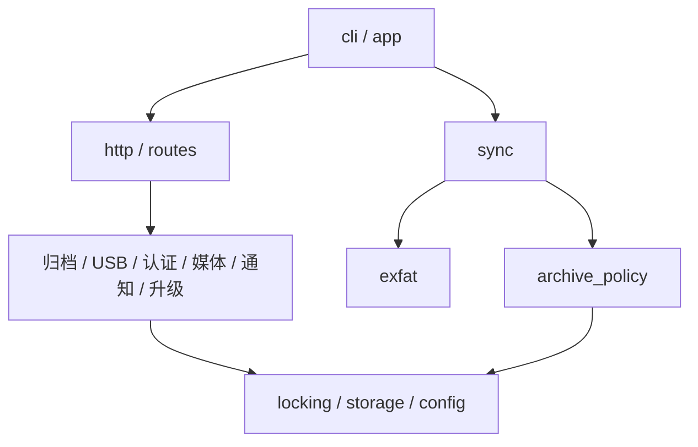

# 模块、运行边界与发布

2.7 的源码是 `src/tesla_sentry/` Python 包。模块可单独导入，依赖通过相对导入声明。构建器只打包文件，不再把函数和变量拼接到同一个命名空间；导入模块和执行自检都不启动服务、不创建缓存目录、不操作 USB。

## 代码地图

| 模块 | 职责 |
| --- | --- |
| `config.py` | 配置文件、环境变量、默认值和启动校验 |
| `cli.py` | 源码命令、独立入口、安装工具和旧客户端迁移 |
| `app.py` | HTTP 服务、后台任务、信号和退出清理 |
| `http.py`、`routes.py` | 请求入口、统一认证、错误响应、声明式路由 |
| `http_get.py`、`http_post.py` | 单个接口的编排，调用业务模块 |
| `archive.py`、`archive_policy.py` | 事件列表、路径边界、两种归档路径的共同策略 |
| `exfat.py` | 只读卷解析；以显式生命周期管理文件描述符 |
| `sync.py` | 文件稳定性确认、增量同步、镜像替换与退出处理 |
| `usb.py`、`locking.py` | 镜像管理会话、超时恢复、线程与进程互斥 |
| `retention.py` | 归档保留策略、容量保护和健康日志 |
| `media.py`、`transcode.py`、`telemetry.py` | 缓存、转码、合成及视频码流遥测解析 |
| `auth.py` | 认证凭据、会话和登录失败限制 |
| `notifications.py` | 推送配置、事件选择和调度 |
| `feishu.py` | HTTP 传输、按应用凭据隔离的令牌缓存、飞书接口 |
| `qqbot.py` | QQ 官方凭据缓存、单聊/群聊主动消息、本地媒体分片上传 |
| `vehicle_assets.py` | 锁车音转换与队列同步、PNG 涂装校验及原子写入 |
| `push_media.py` | 推送附件转码与行车信息水印 |
| `storage.py` | 临时文件、fsync、原子替换等持久化操作 |
| `update_package.py` | ZIP 格式生成与校验、文件白名单和大小边界 |
| `deployment.py`、`updates.py` | 手动 URL 下载、暂存自检、版本切换与回滚；状态读取不访问远端 |
| `assets.py`、`web/` | 源码和独立入口共用的静态资源 |

依赖方向如下；测试会检查 Python 包中不存在循环导入。

业务模块拥有自己的状态。例如，改密后接口读取 `auth` 模块里的当前凭据，USB 接口读取 `usb` 模块里的会话状态，避免跨文件复制可变全局值。配置在进程启动时加载；改变配置后重启对应服务。

## 前端边界

`index.html` 保存页面结构，`app.css` 保存样式。`app.js` 负责页面交互，显式导入 `i18n.js`、`theme.js`、纯函数模块 `model.js` 及本地 SVG 图标模块 `icons.js`。翻译表只有 `web/i18n.json` 一个来源，所有翻译值必须是字符串。2.10 的资料库、登录、播放器和设置采用同一主题色；图标和系统字体不依赖外部服务。

现有静态与动态 HTML 中的操作入口，通过 `app.js` 末尾的明确列表暴露到 `window`；页面内部状态保留在模块作用域。这个列表是兼容边界，新增操作应同时更新它。没有把整个应用状态放回全局对象。

## 运行和退出

源码模式使用 `PYTHONPATH=src python3 -m tesla_sentry`。独立入口使用 `python3 sentry-viewer.py` 和 `python3 tesla-live-sync.py`，保留原有安装脚本调用方式。`serve`、`sync` 和 `check` 为明确的命令；安装器原有的 `--usb-lock-exec`、`--archive-copy`、`--install-release` 和 `--ota-check` 仍可使用。

Web 服务先绑定端口，再启动后台任务；没有镜像或 Gadget 时可只浏览归档。SIGINT/SIGTERM 会通知后台任务停止、关闭 HTTP 服务并尝试清理自身持有的 USB 会话。同步服务在退出和镜像替换时关闭旧文件描述符。后台网络请求仍按各自的超时结束，停止信号不会强制中断正在进行的第三方 HTTP 请求。

USB 与归档锁的顺序固定为 USB → 归档。卸载失败不能重新导出同一镜像；网页管理器保留锁并安排重试。锁文件不能在运行过程中删除。

## 构建和版本切换

`tools/build.py` 对源码执行 Python 3.7 语法兼容检查，使用固定顺序与时间戳生成压缩包，再嵌入两个 Python 启动器。内存导入器保留正常的包命名空间和资源加载。设备不需要解压源码、安装第三方依赖或运行 Node.js。

`src/tesla_sentry/__init__.py` 中的 `__version__` 是版本号来源。`tools/make_release.py` 更新它并重新生成启动器、`dist/release.json` 和 `version.json`。生成文件和源码必须在同一次提交中更新；`tools/build.py --check` 可以检查是否遗漏。

部署时验证文件白名单、程序包与单文件 SHA-256，以及两个入口实际自检返回的版本。验证通过后才切换 `current`。SHA-256 核对下载一致性，不能代替对发布源的信任。旧版本仍可通过 `previous-release.json` 整包回滚，用户配置和录像不在版本目录中。

从 2.9.0 起不再发现远端版本，也没有默认 GitHub 下载源。`tools/package_update.py` 从已构建产物生成确定性 ZIP；`update_package.py` 是打包端与设备端共用的格式校验器。`updates.py` 负责接收本地 ZIP 上传并安装，`GET /api/ota/status` 和旧 `/api/ota/check` 仅读取本机状态。完整发布流程见 [离线上传 ZIP 更新](UPDATES.md)。

## 验证范围

Python 测试覆盖归档策略、部分复制补全、跨进程互斥、配置优先级、procd 子进程加载、版本迁移与回滚、HTTP 认证、分段下载、路径越界、后台任务退出和 exFAT 文件描述符回收。HTTP 测试只监听本机回环地址。

前端模块测试使用 Node 的 VM 检查导入、片段分组、主题、语言及页面初始化。`tests/ui.cjs` 可连接 `tools/preview_ui.py` 的只读本机预览，使用模拟 API、演示缩略图和可选视频夹具检查响应布局、筛选、播放器、设置焦点、对比度和更新表单；它不是实车录制测试。真实 F50 的 USB Gadget、车机录制、ffmpeg 负载和推送链路仍需要设备验证。
